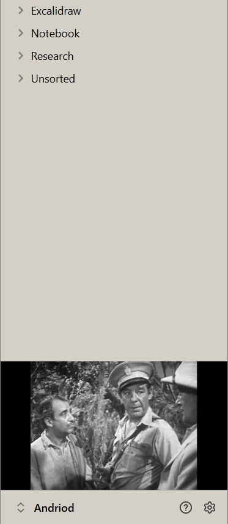

# Matinee

A small black-and-white film screen in your Obsidian sidebar. Matinee plays random public-domain films from the [Internet Archive](https://archive.org), docked edge to edge under your file list.

## Features

- **Old films, chosen at random:** film noir, sci-fi and horror, the silent era, classic features, newsreels and shorts, and early cartoons. Pick which of these it draws from in settings.
- **Always black and white:** any colour film is shown in grey so the look stays consistent. You can turn this off.
- **Starts part-way through:** drops you into a scene instead of the opening credits. You can turn this off.
- **Out of the way:** the title, year and controls only appear when you hover. Controls: pause, another film, sound on or off, and open the film's page on archive.org.
- **Top or bottom:** sits at the bottom of the left sidebar above the vault name, or at the top.
- **Shape and fit:** classic 4:3 or wide 16:9, filling the screen or showing the whole picture.
- **Blend with theme:** makes the film slightly see-through (92% by default, adjustable) so your theme shows through and the screen blends into the sidebar.
- **Quiet by default:** starts muted, with its own volume setting.
- **Polite:** pauses when you close the sidebar or minimise Obsidian, and doesn't repeat any of your last 40 films.

Commands: **Next film**, **Show or hide the film**, and **Sound on or off**. Set your own hotkeys in **Settings → Hotkeys**.

## Network use

Matinee needs an internet connection. It contacts **archive.org** only:

- `https://archive.org/advancedsearch.php` to find films in the chosen collections
- `https://archive.org/metadata/<id>` to find a playable video file for the chosen film
- `https://archive.org/download/<id>/<file>` to stream the video

No account, no tracking and no other services. Matinee doesn't send anything from your vault anywhere. It saves its settings and a list of the last 40 film IDs it played (to avoid repeats) in the plugin's own `data.json`.

## About the films

The films come from public-domain and freely licensed collections on the Internet Archive. Matinee streams them directly from archive.org and doesn't store or redistribute them. If you enjoy them, consider [supporting the Internet Archive](https://archive.org/donate).

## Install

From Obsidian: **Settings → Community plugins → Browse**, search for **Matinee**, then **Install** and **Enable**.

Desktop only.

## Support

Made by [AshOtis](https://github.com/AshOtis). If you like it, you can [buy me a coffee](https://buymeacoffee.com/ashotis). Found a bug or have an idea? [Open an issue](https://github.com/AshOtis/matinee/issues). It's the best way to reach me, and every report gets read.

## Licence

[GNU AGPL v3 or later](LICENSE) © AshOtis
